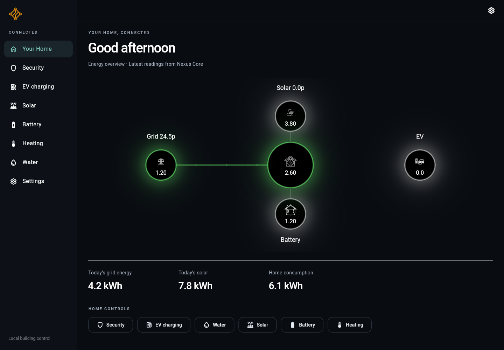

# Nexus

Experimental Flutter interface for a local-first intelligent building platform. The existing Riverpod state, Core API repository, animated energy network and water controls are retained. The Python backend is a separate project.

## Current interface

- Responsive dark dashboard with desktop-only node/text enlargement, daily energy totals and home controls.
- Persistent desktop navigation; compact touchscreens keep the systems menu. A shared logo uses the supplied Settings asset and appears once per screen.
- Solar and Battery overviews use Core readings, with energy-flow visualisation and clearly marked forecasting/optimisation placeholders.
- Heating overview prepares house and zone temperatures, energy usage, schedules and future optimisation without inventing readings.
- Security overview uses the existing simulated alarm controller and preview zones. It is explicitly labelled as a preview, with space for future cameras and activity.
- EV overview puts a larger vehicle illustration, battery level and charging state first, followed by charging, climate, scheduling, location and session areas. Existing repository commands remain; unavailable vehicle integrations are identified.
- Water overview shows flow and supply status, existing valve controls, consumption summaries, usage charts and leak/alert areas. Optional meter data is used when supplied; the current legacy API does not expose totals or history.
- All overview and Settings pages have shared Back and Dashboard navigation, including loading and offline states.
- Every Settings item opens an appropriate themed destination. Unimplemented configuration is labelled; the existing alarm-name editor still updates the current session.

## Verification

- Web build passes.
- 26 widget tests cover phone, NSPanel-sized, tablet and desktop layouts; Settings navigation; alarm preview/name changes; energy-node taps; EV command failure; missing versus zero readings; water valve commands/locks; rejected and duplicate commands; stale status; and Dashboard access through the actual application routes.
- Static analysis of the changed app paths has no errors. Existing style/deprecation notices and an unused helper remain.
- Full-project static analysis still reports inherited errors in older repository and sample files. See [review notes](REVIEW.md) and [analysis output](docs/full-project-analysis.txt).
- Physical Home Assistant, charger, alarm and NSPanel Pro hardware have not been verified.

## Run

```sh
flutter pub get
flutter test
flutter run -d chrome --dart-define=NEXUS_API_URL=http://YOUR_CORE:8000
```

Replace `YOUR_CORE` with your local server address. `NEXUS_API_URL` configures both the energy repository and water service; other supplied services retain their existing URLs. Web builds serve the renderer and licensed Roboto fonts locally.

Charging commands require matching local Core endpoints. A successful API response is not hardware confirmation. Heating configuration, camera access, forecasts, optimisation and most Settings preferences remain placeholders.

## Previews

All preview energy and water values are **simulated**, not readings from a real property. Screen-size checks do not certify physical devices.



[Phone](docs/dashboard-mobile.png) · [Tablet](docs/dashboard-tablet.png) · [NSPanel-sized](docs/dashboard-nspanel.png)

[Security](docs/overview-security.png) · [EV](docs/overview-ev.png) · [Solar](docs/overview-solar.png) · [Battery](docs/overview-battery.png) · [Heating](docs/overview-heating.png) · [Settings](docs/overview-settings.png) · [Water](docs/overview-water.png)

This is development source, not a production release.

[Water on phone](docs/water-mobile.png) · [Water on NSPanel-sized screen](docs/water-nspanel.png) · [Water with legacy API fields](docs/water-legacy.png) · [EV on phone](docs/ev-mobile.png)

The Water screenshots with totals/history illustrate optional future meter fields. See [the water data contract](docs/water-data-contract.md) for exactly what is supported; the supplied Python API is unchanged.
